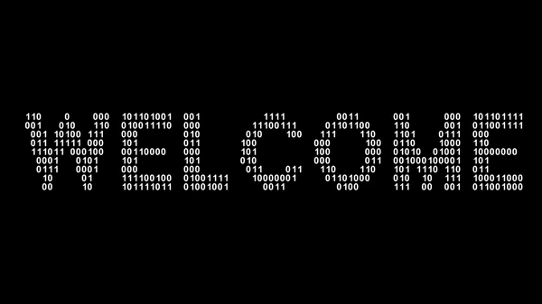

  

  <h1>Hi, I'm Robert Alin! 👋</h1>
  <h3>🎓 4th-Year Computer Science and Engineering Student – University of Bucharest (FMI - CTI)</h3>
  

    💡 Passionate about <strong>Software Development</strong>, <strong>AI</strong>, and <strong>Web Technologies</strong>  
     🧠 Bringing ideas to life through clean code, structured databases, and creativity  
     📫 <a href="mailto:stoian.alin19@yahoo.com">stoian.alin19@yahoo.com</a>
  

---

## 🧰 Tech Stack
*A selection of my main tools, languages, and frameworks:*

**Languages:**  

  
  
  
  
  
  

**Web & Frameworks:**  

  
  
  
  
  
  

**Databases & ORM:**  

  
  
  
  

---

## 🧠 Featured Projects

- 🚀 **Evolve (Thesis Project)**  
  A complex web platform built with **Next.js**, **Prisma ORM**, and **PostgreSQL**.

- 🎓 **Baccalaureate Question Generator**  
  An educational tool created using **Python** and **Streamlit** to dynamically generate exam questions.

- 🕸️ **Team & Project Management System**  
  **ASP.NET Core MVC** + **PostgreSQL** – full CRUD, validation, and filtering.

- 🎮 **AI Search Algorithm Visualizer**  
  BFS, DFS, A\* in scenarios like 8-puzzle, maze, and Pacman. Includes computer vision concepts (e.g., smiley face pattern recognition).

- 🧬 **ASCII Art with Genetic Algorithms**  
  Evolutionary optimization to generate text-based art in Python.

---

## 📊 GitHub Stats

  
  

---

## 🌱 Fun Facts & Beyond Code

> I love turning complex algorithms into something visual, clear, and interactive. When I'm not writing code or debugging databases, you can find me relaxing at a fitness club with a good spa/sauna, grinding competitive CS matches on FACEIT, keeping up with the live-action One Piece, or checking out car audio customisations.

---

🚀 Thanks for stopping by! See you in code! 🧠

